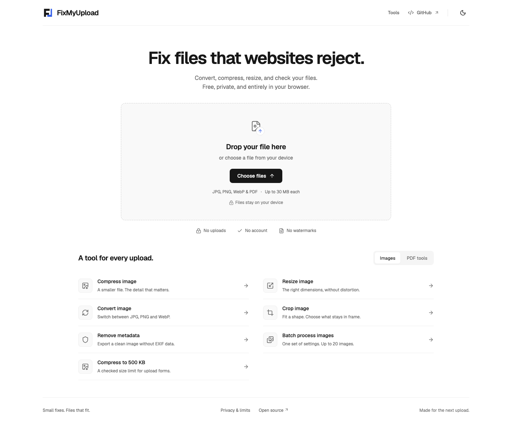
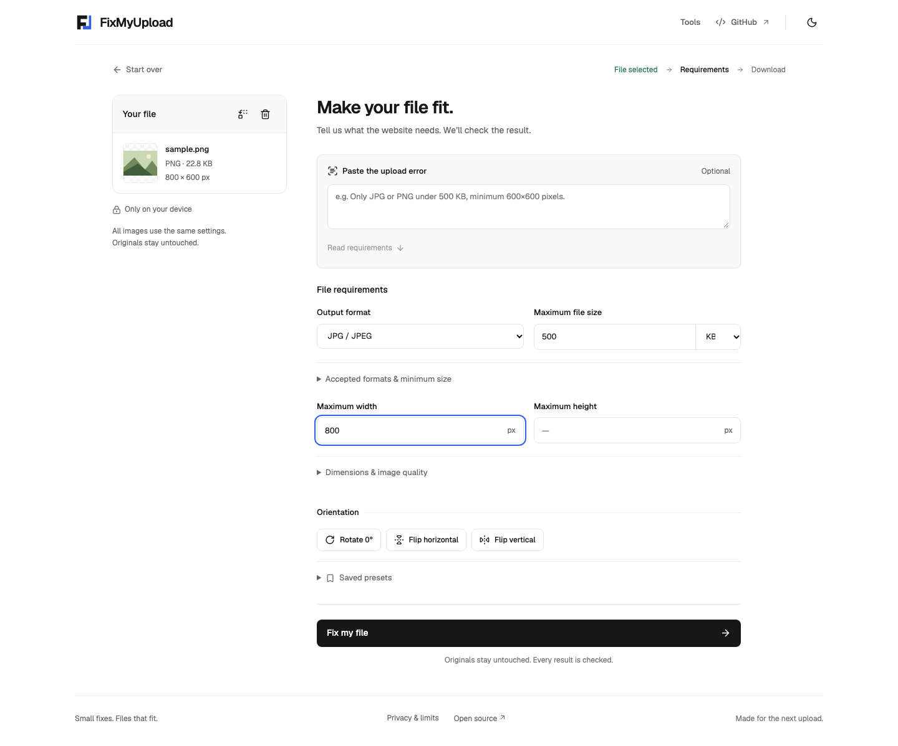
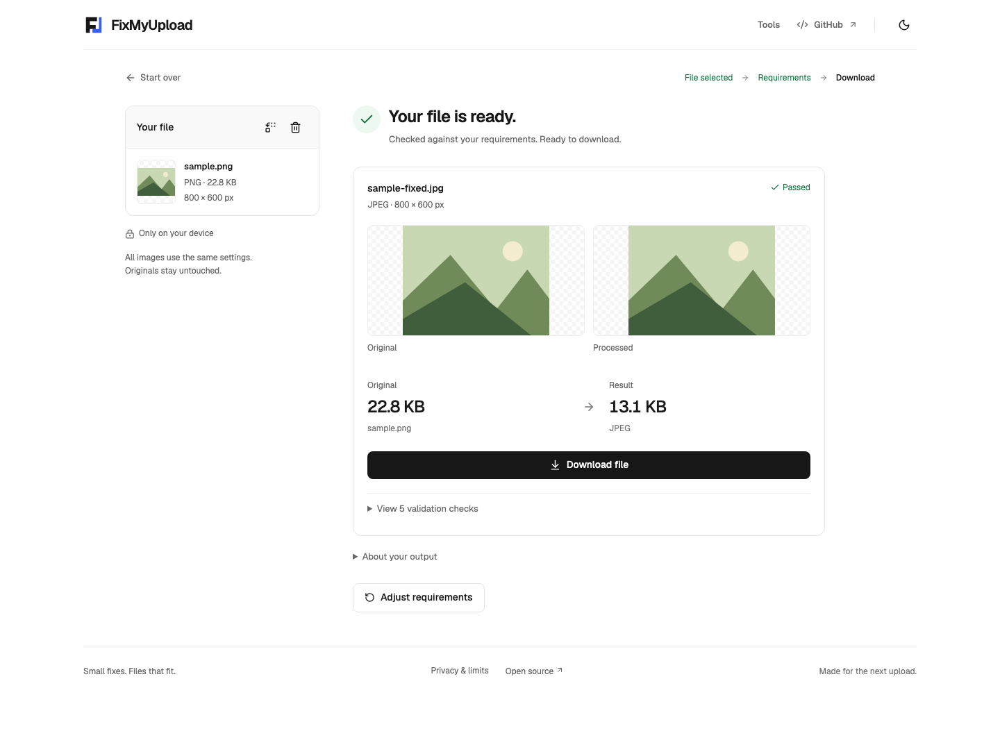

<p align="center">
  <picture>
    <source media="(prefers-color-scheme: dark)" srcset="assets/branding/logo-dark.svg">
    
  </picture>
</p>
<p align="center"><strong>Fix files that websites reject.</strong></p>
<p align="center">Convert, compress, resize and check images and PDFs against a website's upload requirements.<br>Free, local to your browser, and open source.</p>
<p align="center">
  <a href="https://github.com/spockplayer2-alt/fixmyupload/actions/workflows/ci.yml"></a>
  <a href="LICENSE"></a>
</p>

[**Open FixMyUpload**](https://spockplayer2-alt.github.io/fixmyupload/)



<details>
<summary>See the workspace and results</summary>




</details>

## Why FixMyUpload?

“Only JPG under 500 KB.” “At least 600 × 600 pixels.” “No more than three pages.”

A rejected upload shouldn't send you through a string of unrelated tools. FixMyUpload brings the common fixes together, then checks the actual output against the restrictions you entered.

## What it does

- Convert JPEG, PNG and WebP images with browser-native encoders.
- Search for an image size limit by lowering quality, then dimensions where permitted.
- Resize with minimum, maximum or exact dimensions; preserve shape, center-crop or add background padding.
- Keep transparency in PNG/WebP, or choose a background for JPEG.
- Rotate and flip images, choose crop placement, and remove image metadata.
- Process up to 20 images with shared settings and download real outputs as a ZIP.
- Save reusable presets on your device with an explicit Save action; only settings are stored.
- Read common English upload errors with a deterministic parser. Review detected limits before applying them; ambiguous messages require confirmation.
- Turn images into an A4 PDF, merge PDFs, extract or remove pages, reorder every page, split a PDF into individual files, or rotate selected pages. Preview real PDF pages locally and select/reorder them with keyboard-accessible controls.
- Compare original metadata, requirements and measured output. A failed check is always shown as a failure.
- Download sensible filenames without accounts, watermarks or subscriptions.
- Use either theme on desktop or mobile, with keyboard access and reduced-motion support.

## How it works

1. Drop a file into **Image fixer**, or select several files in **PDF tools**.
2. Paste the website's error or enter its format, size, dimension and page limits.
3. Choose **Fix my file** or a PDF operation.
4. Review the checks and download the result.

Files are selected locally. “Upload” refers to the website you're trying to use; FixMyUpload itself doesn't upload your files.

## Privacy

File processing, previews and error parsing run on your device. There is no backend, analytics, tracking, external conversion service, AI API or document storage. Presets persist settings only after you choose **Save preset**, and can be deleted in the app. Temporary object URLs are revoked when files/results are replaced or the tool is closed. Reloading clears the session.

The host receives normal requests for the app, including your IP address. Following the GitHub link opens GitHub. The README's status badges are external images; the application itself doesn't load those badges. See the [privacy policy](docs/privacy.md).

## Supported formats

| Input           | Output          | Operations                                                          |
| --------------- | --------------- | ------------------------------------------------------------------- |
| JPEG, PNG, WebP | JPEG, PNG, WebP | Conversion, compression, resizing, validation                       |
| JPEG, PNG, WebP | PDF             | One image per A4 page, in selection order                           |
| Unencrypted PDF | PDF             | Merge, split, extract, remove, reorder, rotate, preview, validation |

WebP encoding depends on browser support; an unsupported encoder produces an error. Animated inputs become a single frame. Image processing removes metadata and honors EXIF orientation. HEIC, GIF, SVG, Office documents and PDF-to-image conversion are not supported.

## Getting started

Use Node.js **24 or newer** and npm.

```bash
git clone https://github.com/spockplayer2-alt/fixmyupload.git
cd fixmyupload
npm ci
npm run dev
```

Open the local URL printed by Vite. No keys or environment variables are needed.

## Development

| Command                | Purpose                                       |
| ---------------------- | --------------------------------------------- |
| `npm run dev`          | Local development server                      |
| `npm run build`        | Type-check and build into `dist/`             |
| `npm run preview`      | Serve the production build locally            |
| `npm run typecheck`    | Strict TypeScript checks                      |
| `npm run lint`         | ESLint and React hooks checks                 |
| `npm test`             | Unit and React integration tests              |
| `npm run test:e2e`     | Chromium desktop and mobile flows             |
| `npm run format`       | Apply Prettier formatting                     |
| `npm run format:check` | Check formatting                              |
| `npm run check`        | Types, lint, unit/integration tests and build |

Before browser tests, install the test browser:

```bash
npx playwright install chromium
npm run test:e2e
```

CI installs its Linux browser dependencies with `npx playwright install --with-deps chromium`.

## Technical details

React + strict TypeScript on Vite. Custom CSS uses a documented neutral token system, locally bundled Geist, and Lucide icons. Canvas does image encoding; a bounded quality/dimension search aims for the requested byte limit without crossing minimum dimensions. Outputs are decoded again and validated after encoding.

PDF operations use `pdf-lib` inside short-lived, cancellable Web Workers, loaded only when a PDF is needed. PDF.js and its local worker load when the page preview is opened. ZIP downloads use a lazy-loaded fflate worker. Workers time out after 60 seconds and keep original buffers intact. Requirements parsing and validation are plain TypeScript modules with no network dependencies.

- `src/features/image/`: safe image decoding, dimensional planning and encoding
- `src/features/pdf/`: PDF engine, message protocol and worker lifecycle
- `src/features/parsing/`: conservative English requirement recognition
- `src/features/validation/`: conflict detection and output checks
- `src/components/`: upload, requirements, results and branding
- `tests/`: unit contracts, React interaction tests, real browser processing and downloads

The build is a static `dist/` directory, including 14 working tool routes, per-page metadata, a sitemap and a custom 404. Relative asset paths support GitHub Pages and subdirectory hosting. See [architecture and limits](docs/architecture.md), [visual system](docs/visual-system.md), and the [roadmap](docs/roadmap.md).

## Limits worth knowing

- 30 MB per file, 60 MB combined input, 20 input files, 12 megapixels per image and 100 pages per PDF/output.
- No advanced PDF compression, OCR, encrypted PDFs or digital-signature preservation. PDF restructuring may lose forms, bookmarks and accessibility structure. Keep originals.
- JPEG/WebP quality search stops at 20%. PNG encoding is lossless, so reducing dimensions may be necessary. Exact dimensions and minimum sizes can make a byte target unattainable. The app reports failed checks and lets you download a visibly noncompliant result if useful.
- Center-cropping removes edges. Padding uses the chosen background. Enlarging cannot recover detail. Color profiles and image metadata are not preserved; browser encoding can vary.
- English parsing covers explicit formats, maximum sizes, dimensions, aspect ratios and maximum pages. It cannot understand every website's instructions. Inspect the values; website content checks, face recognition, DPI, and document semantics are outside scope.
- Use a current browser with Canvas, `createImageBitmap` and module Web Workers. Large operations use memory on your device. PDFs stay off the main thread; image decoding/drawing can briefly occupy it.
- Minimum byte limits are validated, not achieved by adding meaningless bytes. A result below the requested minimum is marked as failed.
- Image transforms use the current settings for every image in the batch. A batch stops on a failed conversion; no partial success is presented.
- PDF thumbnails render in windows of 12 pages to bound memory.
- A valid file can still be rejected by a website with additional undisclosed checks.

## Contributing

See [CONTRIBUTING.md](CONTRIBUTING.md) for setup, useful checks and how to propose changes. Bug reports are welcome; please use synthetic examples rather than personal documents.

## Security

See [SECURITY.md](SECURITY.md) for private vulnerability reporting. Don't attach sensitive files to public issues.

## License

[MIT](LICENSE). Dependency licenses remain with their respective authors.

## Author

Created by [spockplayer2-alt](https://github.com/spockplayer2-alt).
